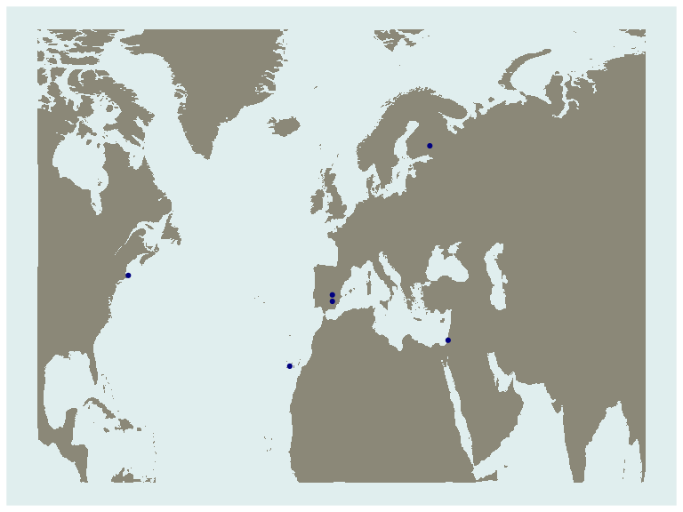
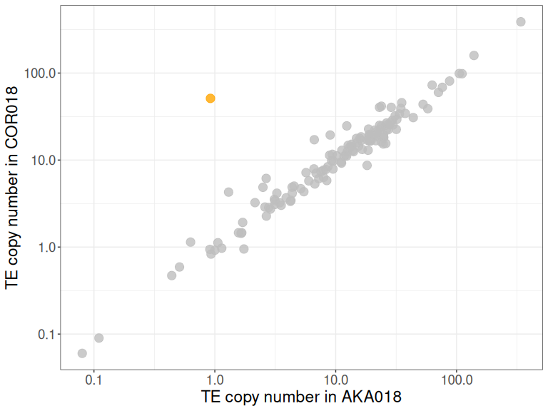
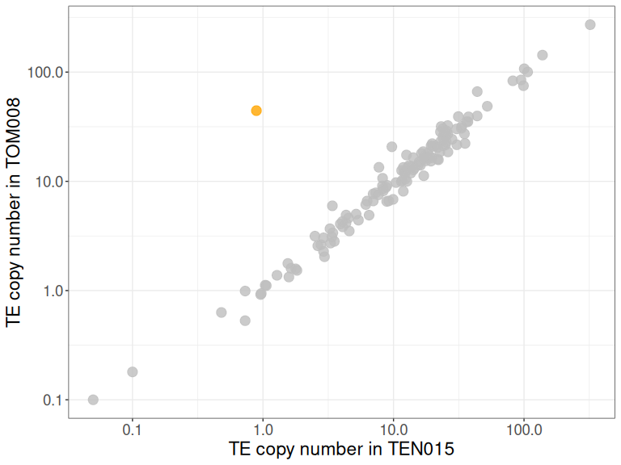
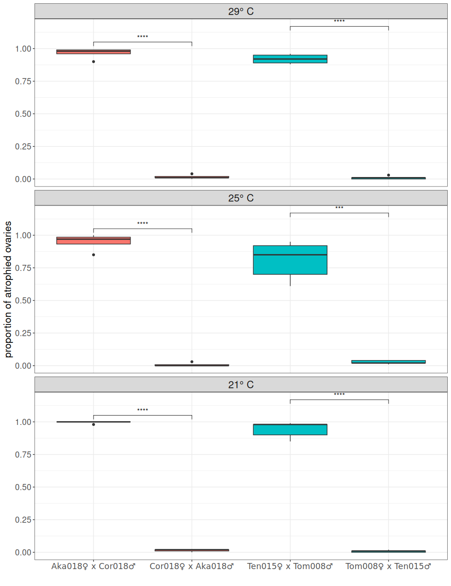
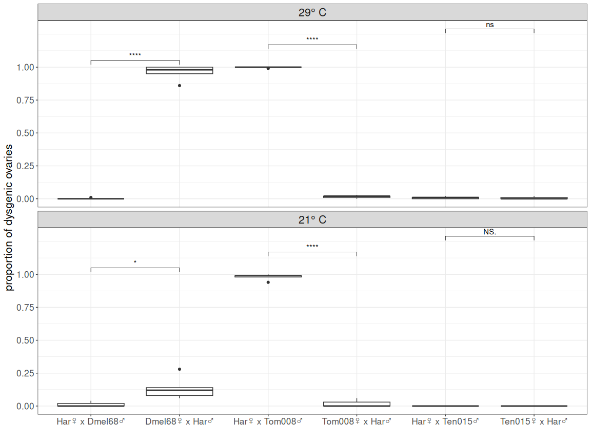
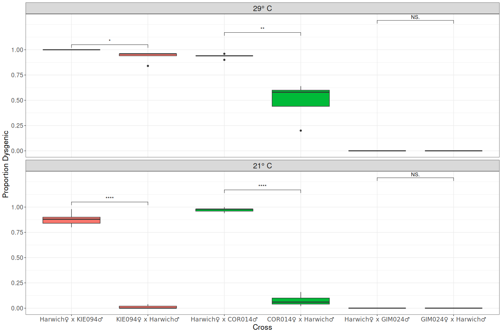
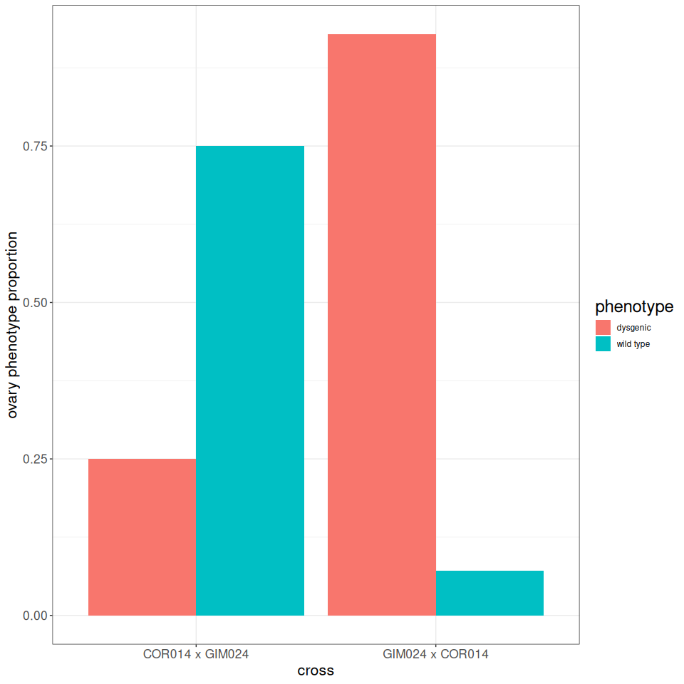

Transib General Plots
================
2026-10-20

Worldmap for figure 1:

``` r
library(tidyverse)
```

    ## ── Attaching core tidyverse packages ──────────────────────── tidyverse 2.0.0 ──
    ## ✔ dplyr     1.2.1     ✔ readr     2.2.0
    ## ✔ forcats   1.0.1     ✔ stringr   1.6.0
    ## ✔ ggplot2   4.0.3     ✔ tibble    3.3.1
    ## ✔ lubridate 1.9.5     ✔ tidyr     1.3.2
    ## ✔ purrr     1.2.2     
    ## ── Conflicts ────────────────────────────────────────── tidyverse_conflicts() ──
    ## ✖ dplyr::filter() masks stats::filter()
    ## ✖ dplyr::lag()    masks stats::lag()
    ## ℹ Use the conflicted package (<http://conflicted.r-lib.org/>) to force all conflicts to become errors

``` r
meta<-read_tsv(file="/home/anna/transib_ana/Figures4paper/meta_fig1.txt")
```

    ## Rows: 6 Columns: 3
    ## ── Column specification ────────────────────────────────────────────────────────
    ## Delimiter: "\t"
    ## chr (1): Strain
    ## dbl (2): lat, long
    ## 
    ## ℹ Use `spec()` to retrieve the full column specification for this data.
    ## ℹ Specify the column types or set `show_col_types = FALSE` to quiet this message.

``` r
world_map <- map_data("world") %>% filter(region != "Antarctica")%>%filter(lat>=10 & lat <80 ,long<100&long>-100)

sampl_map<-ggplot()+geom_map(data = world_map, map = world_map, aes(x=long, y=lat, map_id = region), color = "white", fill = "cornsilk4", linewidth = 0)+
  geom_point(data = meta,aes(x=long,y=lat),color="navy")+
  theme(axis.text = element_blank(),axis.title = element_blank(),axis.ticks = element_blank(),
        legend.position = "right",panel.grid = element_blank(),panel.background = element_rect(fill="azure2"))
```

    ## Warning in geom_map(data = world_map, map = world_map, aes(x = long, y = lat, :
    ## Ignoring unknown aesthetics: x and y

``` r
sampl_map
```

<!-- -->

``` r
#ggsave(sampl_map,file="/Users/annahaider/transib_ana/Figures4paper/sampling_map.pdf",
#width=8,height = 6)
```

TE-CN plots for figure 1:

``` r
fig1_cnest<-read_csv(file="/home/anna/transib_ana/sr_Almo/deviate_analysis/deviate_summary.csv")%>%
  mutate(Sample=gsub("Almo_","",Sample),HQ_reads=as.numeric(HQ_reads))%>%
  filter(Sample!="Sample")%>%
  select(-All_reads)%>%
  pivot_wider(names_from = Sample,values_from = HQ_reads)%>%
  mutate(colorcode=ifelse(TE=="Transib_Riccardo","yes","no"))
```

    ## Rows: 539 Columns: 4
    ## ── Column specification ────────────────────────────────────────────────────────
    ## Delimiter: ","
    ## chr (4): Sample, TE, All_reads, HQ_reads
    ## 
    ## ℹ Use `spec()` to retrieve the full column specification for this data.
    ## ℹ Specify the column types or set `show_col_types = FALSE` to quiet this message.

    ## Warning: There was 1 warning in `mutate()`.
    ## ℹ In argument: `HQ_reads = as.numeric(HQ_reads)`.
    ## Caused by warning:
    ## ! NAs introduced by coercion

``` r
cnest_AKA018vsCOR018<-ggplot(fig1_cnest,aes(x=AKA018,y=COR018,color=colorcode))+
  geom_point(alpha=0.8,size=4)+
  scale_color_manual(values=c("grey","orange"))+
  scale_x_log10()+
  scale_y_log10()+
  theme_bw()+
  theme(legend.position = "none",
        axis.title = element_text(size=17),
        axis.text = element_text(size=14))+
  labs(x="TE copy number in AKA018",
       y="TE copy number in COR018")

cnest_TEN015vsTOM008<-ggplot(fig1_cnest,aes(x=TEN015,y=TOM008,color=colorcode))+
  geom_point(alpha=0.8,size=4)+
  scale_color_manual(values=c("grey","orange"))+
  scale_x_log10()+
  scale_y_log10()+
  theme_bw()+
  theme(legend.position = "none",
        axis.title = element_text(size=17),
        axis.text = element_text(size=14))+
  labs(x="TE copy number in TEN015",
       y="TE copy number in TOM008")

cnest_AKA018vsCOR018
```

<!-- -->

``` r
cnest_TEN015vsTOM008
```

<!-- -->

``` r
#ggsave(cnest_AKA018vsCOR018,file="/Users/annahaider/transib_ana/sr_Almo/cnest_AKA018vsCOR018.png",
#       width=8,height=6)
#ggsave(cnest_TEN015vsTOM008,file="/Users/annahaider/transib_ana/sr_Almo/cnest_TEN015vsTOM008.png",
#       width=8,height=6)
```

HD plot for figure 1:

``` r
library(ggpubr)
order_ACTT<-c("Aka018♀ x Cor018♂","Cor018♀ x Aka018♂","Ten015♀ x Tom008♂","Tom008♀ x Ten015♂")

ACTT_alltemps<-read_csv(file="/home/anna/transib_ana/Transib1_Hybrid_Dysgenesis_Experiment.csv")%>%
  mutate(cross = paste0(sub("x.*", "", ID), "♀ x ", sub(".*x", "", sub("_.*", "", ID)), "♂"))%>%
  mutate(cross = factor(cross, levels = order_ACTT),
         Temperature=paste0(Temperature,"° C"))
```

    ## Rows: 58 Columns: 12
    ## ── Column specification ────────────────────────────────────────────────────────
    ## Delimiter: ","
    ## chr (5): ID, Female, Male, Dissector, %_Dysgenic
    ## dbl (7): Temperature, rep, Normal, Intermediate, Dysgenic, Prop_Dysgenic, Pair
    ## 
    ## ℹ Use `spec()` to retrieve the full column specification for this data.
    ## ℹ Specify the column types or set `show_col_types = FALSE` to quiet this message.

``` r
ACTT_alltemps$Temperature<-factor(ACTT_alltemps$Temperature,levels = c("29° C","25° C","21° C"))

plot_ACTT<-ggplot(ACTT_alltemps,aes(x=cross,y=Prop_Dysgenic,fill = factor(Pair)))+
  geom_boxplot(show.legend = FALSE) +
  facet_wrap(.~Temperature,ncol=1)+
  labs(x = "", y = "proportion of atrophied ovaries") +
  stat_compare_means(comparisons = list(c("Aka018♀ x Cor018♂","Cor018♀ x Aka018♂"),
                                        c("Ten015♀ x Tom008♂","Tom008♀ x Ten015♂")),
                     method = "t.test", label = "p.signif") +
  scale_y_continuous(breaks = c(0, 0.25, 0.50, 0.75, 1)) +
  theme_bw()+
  theme(axis.title = element_text(size = 16),
        axis.text = element_text(size=13),
        title = element_text(size = 18),
        strip.text.x = element_text(size = 16),
        axis.text.x = element_text(family = "DejaVu Sans"))

plot_ACTT
```

<!-- -->

``` r
#ggsave(plot_ACTT,file="/home/anna/transib_ana/ACTT_alltemps.png",
#       width=10,height=13)
```

HD plot for figure 2:

``` r
library(ggpubr)
order_DHTT <- c("Har♀ x Dmel68♂", "Dmel68♀ x Har♂", 
           "Har♀ x Tom008♂", "Tom008♀ x Har♂", 
           "Har♀ x Ten015♂", "Ten015♀ x Har♂")

transib_21deg<-read_csv(file="/home/anna/transib_ana/Transib1_HD_21.csv")%>%
  mutate(cross = paste0(sub("x.*", "", ID), "♀ x ", sub(".*x", "", sub("_.*", "", ID)), "♂"))%>%
  mutate(cross = factor(cross, levels = order_DHTT),
         Temperature=paste0(`Temperature °C`,"° C"))
```

    ## Rows: 28 Columns: 12
    ## ── Column specification ────────────────────────────────────────────────────────
    ## Delimiter: ","
    ## chr (5): ID, Female, Male, Dissector, %_Dysgenic
    ## dbl (7): Temperature °C, rep, Normal, Intermediate, Dysgenic, Prop_Dysgenic,...
    ## 
    ## ℹ Use `spec()` to retrieve the full column specification for this data.
    ## ℹ Specify the column types or set `show_col_types = FALSE` to quiet this message.

``` r
transib_29deg<-read_csv(file="/home/anna/transib_ana/Transib1_HD_29.csv")%>%
  mutate(cross = paste0(sub("x.*", "", ID), "♀ x ", sub(".*x", "", sub("_.*", "", ID)), "♂"))%>%
  mutate(cross = factor(cross, levels = order_DHTT),
         Temperature=paste0(`Temperature °C`,"° C"))
```

    ## Rows: 30 Columns: 12
    ## ── Column specification ────────────────────────────────────────────────────────
    ## Delimiter: ","
    ## chr (5): ID, Female, Male, Dissector, %_Dysgenic
    ## dbl (7): Temperature °C, rep, Normal, Intermediate, Dysgenic, Prop_Dysgenic,...
    ## 
    ## ℹ Use `spec()` to retrieve the full column specification for this data.
    ## ℹ Specify the column types or set `show_col_types = FALSE` to quiet this message.

``` r
transib_DHTT<-rbind(transib_21deg,transib_29deg)%>%
  mutate(Temperature=factor(Temperature,levels=c("29° C","21° C")))

DHTT_plot<-ggplot(transib_DHTT,aes(x=cross,y=Prop_Dysgenic))+
  geom_boxplot(show.legend = FALSE) +
  facet_wrap(.~Temperature,ncol=1)+
  labs(x = "", y = "proportion of dysgenic ovaries") +
  stat_compare_means(comparisons = list(c("Har♀ x Dmel68♂", "Dmel68♀ x Har♂"),
                                        c("Har♀ x Tom008♂", "Tom008♀ x Har♂"),
                                        c("Har♀ x Ten015♂", "Ten015♀ x Har♂")),
                     method = "t.test", label = "p.signif") +
  scale_y_continuous(breaks = c(0, 0.25, 0.50, 0.75, 1)) +
  theme_bw()+
  theme(axis.title = element_text(size = 16),
                   axis.text = element_text(size=13),
                   title = element_text(size = 18),
                  strip.text.x = element_text(size = 16))
DHTT_plot
```

<!-- -->

``` r
#ggsave(DHTT_plot,file="/Users/annahaider/transib_ana/Transib1_HD_DHTT.pdf",
#       width=12,height = 9)
```

Harwich HD plot for figure 4:

``` r
library(ggpubr)
order_HKCG <- c("Harwich♀ x KIE094♂", "KIE094♀ x Harwich♂", 
           "Harwich♀ x COR014♂", "COR014♀ x Harwich♂", 
           "Harwich♀ x GIM024♂", "GIM024♀ x Harwich♂")

wild_21_29deg<-read_csv(file="/home/anna/transib_ana/Wild_strains.csv")%>%
  mutate(cross = paste0(Female, "♀ x ", Male, "♂"))%>%
  mutate(cross = factor(cross, levels = order_HKCG),
         Temperature=paste0(`Temperature °C`,"° C"))%>%
  mutate(Temperature=factor(Temperature,levels=c("29° C","21° C")))
```

    ## Rows: 60 Columns: 12
    ## ── Column specification ────────────────────────────────────────────────────────
    ## Delimiter: ","
    ## chr (5): ID, Female, Male, Dissector, %_Dysgenic
    ## dbl (7): Temperature °C, rep, Normal, Intermediate, Dysgenic, Prop_Dysgenic,...
    ## 
    ## ℹ Use `spec()` to retrieve the full column specification for this data.
    ## ℹ Specify the column types or set `show_col_types = FALSE` to quiet this message.

``` r
HKCG_plot<-ggplot(wild_21_29deg,aes(x=cross,y=Prop_Dysgenic,fill = factor(Pair)))+
  geom_boxplot(show.legend = FALSE) +
  facet_wrap(.~Temperature,ncol=1)+
  labs(x = "Cross", y = "Proportion Dysgenic") +
  stat_compare_means(comparisons = list(c("Harwich♀ x KIE094♂", "KIE094♀ x Harwich♂"),
                                        c("Harwich♀ x COR014♂", "COR014♀ x Harwich♂"),
                                        c("Harwich♀ x GIM024♂", "GIM024♀ x Harwich♂")),
                     method = "t.test", label = "p.signif") +
  scale_y_continuous(breaks = c(0, 0.25, 0.50, 0.75, 1)) +
  theme_bw()+
  theme(axis.title = element_text(size = 16),
        axis.text = element_text(size=13),
        title = element_text(size = 18),
        strip.text.x = element_text(size = 16),
        axis.text.x = element_text(family = "DejaVu Sans"))

HKCG_plot
```

<!-- -->

``` r
#ggsave(HKCG_plot,file="/home/anna/transib_ana/HKCG_plot.png",
#       width = 15,height=10)
```

Wild-cross HD plot for figure 4:

``` r
wc_ana<-read_tsv(file="/home/anna/transib_ana/Rosella_wild_crosses.tsv")%>%
  arrange(cross_ID)%>%
  pivot_longer(cols = c(prop_dys,prop_wild),names_to = "phenotype",values_to = "prop")%>%
  mutate(phenotype=ifelse(phenotype=="prop_dys","dysgenic","wild type"))
```

    ## Warning: One or more parsing issues, call `problems()` on your data frame for details,
    ## e.g.:
    ##   dat <- vroom(...)
    ##   problems(dat)

    ## Rows: 31 Columns: 9
    ## ── Column specification ────────────────────────────────────────────────────────
    ## Delimiter: "\t"
    ## chr (2): cross, notes
    ## dbl (7): WT ovaries, bilateral atrophied, unilateral atrophied, TOT dissecte...
    ## 
    ## ℹ Use `spec()` to retrieve the full column specification for this data.
    ## ℹ Specify the column types or set `show_col_types = FALSE` to quiet this message.

``` r
wild_cross_subplot<-ggplot(subset(wc_ana,cross_ID=="11"),aes(x=cross,y=prop,fill = phenotype))+
  geom_col(position = "dodge")+
  #facet_wrap(.~cross_ID,ncol=3,scales="free_x")+
  labs(y="ovary phenotype proportion")+
  theme_bw()+
  theme(axis.title = element_text(size = 16),
        axis.text = element_text(size=13),
        title = element_text(size = 18),
        strip.text.x = element_text(size = 16))

wild_cross_subplot
```

<!-- -->

``` r
#ggsave(wild_cross_subplot,file="/home/anna/transib_ana/Figures4paper/Rossella_GIM24COR14.pdf",width=10,height=10)
```
